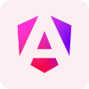
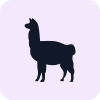
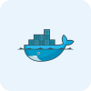

# 🪶 Avinaba Mazumdar

<h3>Full-Stack & AI Systems Engineer (4+ YOE)</h3>
<h3>Shipping TypeScript, React/Next.js, Python/FastAPI & Agentic AI Systems.</h3>

 

- 🔭 **Current Focus**: Designing and building full-stack agentic AI products.
- 🚀 **Performance Mindset**: Low-latency APIs, reliable CI/CD, and zero-downtime releases.
- 🌱 **Passively Exploring**: Web3 Infrastructure and Mobile Development.
- 💬 **Ask Me About**: System Design and Agentic AI Workflows.

---

 

### 📊 Analytics

<h3 align="left">
  
</h3>

  

---

 

### 🚀 Featured

  <a href="https://craftkreate.com" target="_blank" rel="noopener noreferrer">
    <picture>
      <source media="(prefers-color-scheme: dark)" srcset="images/craftkreate-dark.png">
      <source media="(prefers-color-scheme: light)" srcset="images/craftkreate-light.png">
      
    </picture>
  </a>
  &nbsp;&nbsp;
  <a href="https://tabsstack.avinaba.com" target="_blank" rel="noopener noreferrer">
    <picture>
      <source media="(prefers-color-scheme: dark)" srcset="images/tabsstack-dark.png">
      <source media="(prefers-color-scheme: light)" srcset="images/tabsstack-light.png">
      
    </picture>
  </a>

  <a href="https://bayesmarket.avinaba.com" target="_blank" rel="noopener noreferrer">
    <picture>
      <source media="(prefers-color-scheme: dark)" srcset="images/bayesmarket-dark.png">
      <source media="(prefers-color-scheme: light)" srcset="images/bayesmarket-light.png">
      
    </picture>
  </a>
  &nbsp;&nbsp;
  <a href="https://nexusagent.avinaba.com" target="_blank" rel="noopener noreferrer">
    <picture>
      <source media="(prefers-color-scheme: dark)" srcset="images/nexusagent-dark.png">
      <source media="(prefers-color-scheme: light)" srcset="images/nexusagent-light.png">
      
    </picture>
  </a>

---

 

### 🛠️ Ecosystem

<table>
  <tbody>
    <tr>
      <td valign="top" width="180"><b>Languages & Standards</b></td>
      <td>
        &nbsp;
        &nbsp;
        &nbsp;
        &nbsp;
        &nbsp;
        &nbsp;
        &nbsp;
        &nbsp;
        &nbsp;
        &nbsp;
        
      </td>
    </tr>
    <tr>
      <td valign="top" width="180"><b>Frontend & UI</b></td>
      <td>
        &nbsp;
        &nbsp;
        &nbsp;
        &nbsp;
        &nbsp;
        &nbsp;
        &nbsp;
        &nbsp;
        &nbsp;
        &nbsp;
        &nbsp;
        &nbsp;
        &nbsp;
        &nbsp;
        &nbsp;
        
      </td>
    </tr>
    <tr>
      <td valign="top" width="180"><b>Backend & Databases</b></td>
      <td>
        &nbsp;
        &nbsp;
        &nbsp;
        &nbsp;
        &nbsp;
        &nbsp;
        &nbsp;
        &nbsp;
        &nbsp;
        &nbsp;
        &nbsp;
        &nbsp;
        &nbsp;
        &nbsp;
        &nbsp;
        &nbsp;
        &nbsp;
        &nbsp;
        &nbsp;
      </td>
    </tr>
    <tr>
      <td valign="top" width="180"><b>AI, LLMs & Agents</b></td>
      <td>
        &nbsp;
        &nbsp;
        &nbsp;
        &nbsp;
        &nbsp;
        &nbsp;
        &nbsp;
        &nbsp;
        &nbsp;
        &nbsp;
        &nbsp;
        
      </td>
    </tr>
    <tr>
      <td valign="top" width="180"><b>Cloud & DevOps</b></td>
      <td>
        &nbsp;
        &nbsp;
        &nbsp;
        &nbsp;
        &nbsp;
        &nbsp;
        &nbsp;
        &nbsp;
        &nbsp;
        &nbsp;
        
      </td>
    </tr>
    <tr>
      <td valign="top" width="180"><b>Testing, Tools & Services</b></td>
      <td>
        &nbsp;
        &nbsp;
        &nbsp;
        &nbsp;
        &nbsp;
        &nbsp;
        &nbsp;
        &nbsp;
        &nbsp;
        &nbsp;
        &nbsp;
        &nbsp;
        &nbsp;
        &nbsp;
        &nbsp;
        &nbsp;
        &nbsp;
        &nbsp;
        &nbsp;
        &nbsp;
        &nbsp;
        &nbsp;
        &nbsp;
        
      </td>
    </tr>
  </tbody>
</table>
